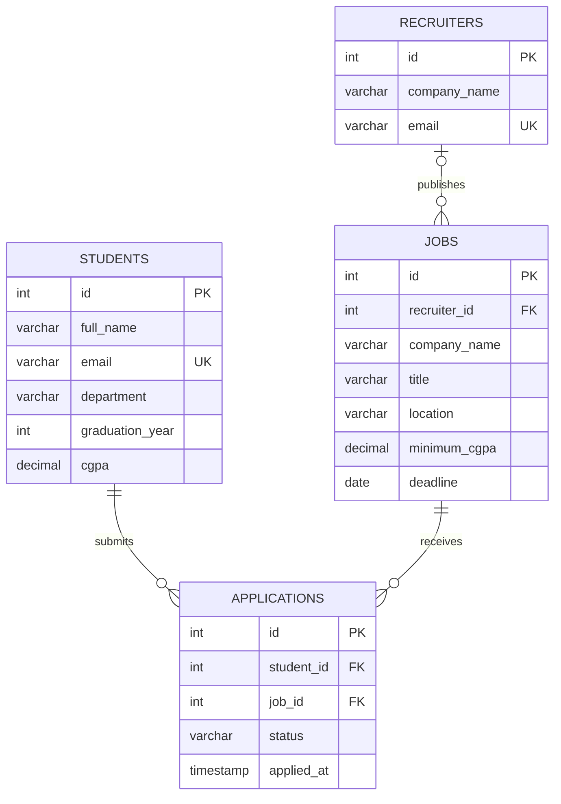

# Database design

## Relationships
- One student can submit many applications.
- One job can receive many applications.
- Each application belongs to one student and one job.
- A recruiter can publish many jobs.
- `UNIQUE(student_id, job_id)` prevents duplicate applications.
